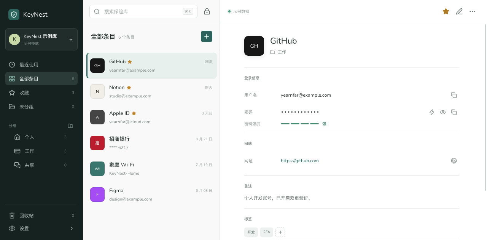

# KeyNest

English | [简体中文](README.zh-CN.md)

Free cross-platform password manager compatible with KeePass.

## Preview



## Features

- Stores vault data locally using the KeePass-compatible KDBX 4.1 format.
- Supports a master password, a key file, or both, including master password changes.
- Supports creating, editing, duplicating, favoriting, searching, and viewing entry history, with a built-in password generator.
- Supports nested groups and drag-and-drop organization of groups and entries.
- Supports automatic locking and trash recovery, with deleted entries retained for 30 days.

## Data Storage

- Vaults use the KeePass-compatible KDBX 4.1 format.
- KDBX files are stored locally at a location selected by the user and are never uploaded to the cloud.
- Vaults can be unlocked with a master password, a key file, or both.
- Master passwords are never persisted; the recent vault list stores only local KDBX file paths.
- New and edited entries are encrypted and written atomically to the current KDBX file.
- The built-in random, memorable, and PIN generators use the system's cryptographically secure random source.

## Development

```bash
make dev
```

Use `make debug` for more detailed logs, or `make build-debug` to create an application bundle with debugging tools enabled.

To preview only the frontend:

```bash
cd frontend
npm run dev
```

## Testing and Building

```bash
make test
make release
```

The macOS application is built at `build/bin/KeyNest.app`.

Additional Wails build arguments can be passed through `BUILD_FLAGS`, for example:

```bash
make release BUILD_FLAGS="-platform windows/amd64"
```

## Updates

macOS users should download `KeyNest-macOS-arm64.dmg`, open it, and drag `KeyNest.app` into the Applications folder. The current macOS package supports Apple Silicon.

Production builds check GitHub Releases from **Settings → About & Updates**. Automatic updates accept only the raw executable matching the current platform and verify its SHA-256 file from the same release before replacing the application. Raw executables are update payloads and are not intended for manual installation.

Releases use `vMAJOR.MINOR.PATCH` tags. After a tag is pushed, `.github/workflows/release.yml` creates a release and uploads:

- `KeyNest-macOS-arm64.dmg` and `KeyNest-macOS-arm64.dmg.sha256` (macOS installer)
- `keynest-darwin-arm64` and `keynest-darwin-arm64.sha256`
- `keynest-windows-amd64.exe` and `keynest-windows-amd64.exe.sha256`

Local `wails dev` and standard `wails build` runs are development builds. They can check for remote versions but do not replace themselves. `make release` and the release workflow read the nearest `vMAJOR.MINOR.PATCH` Git tag from the current commit, remove the leading `v`, and write the version into the application UI, Go binary, and macOS/Windows package metadata. They also set `BuildMode=production` through linker flags to enable automatic installation.
